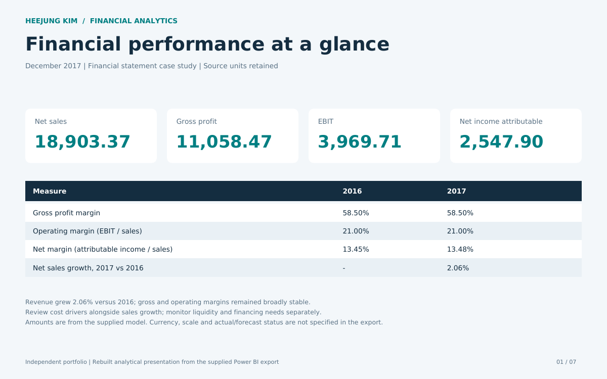
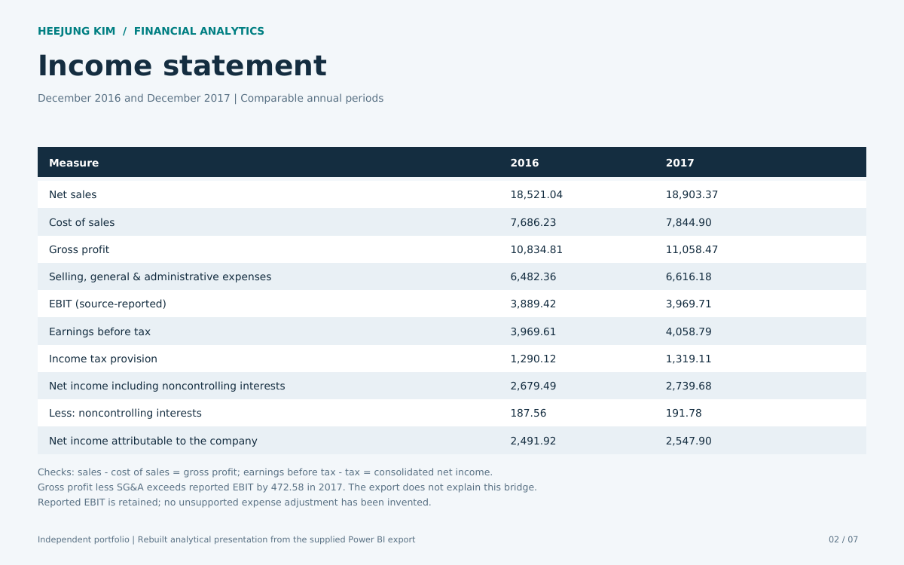
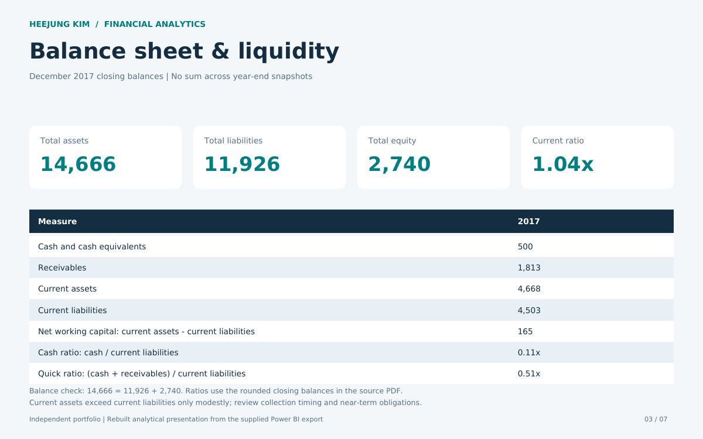
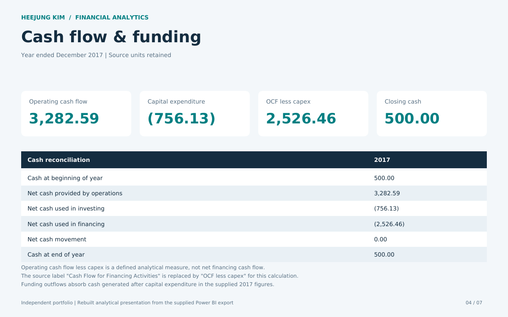
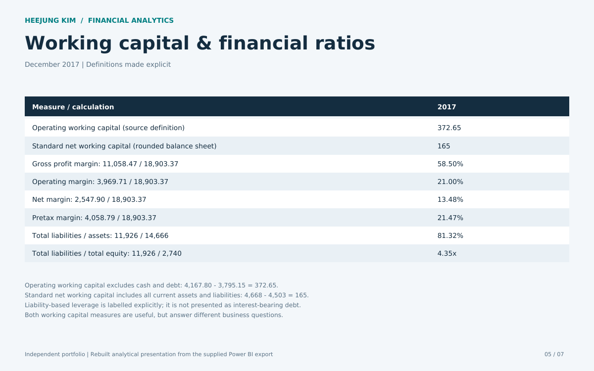
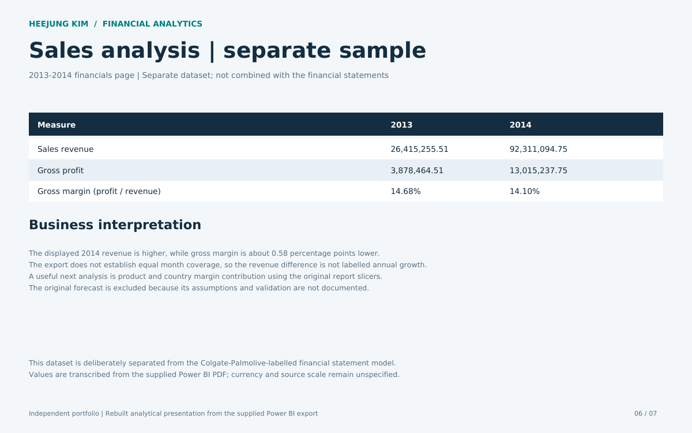
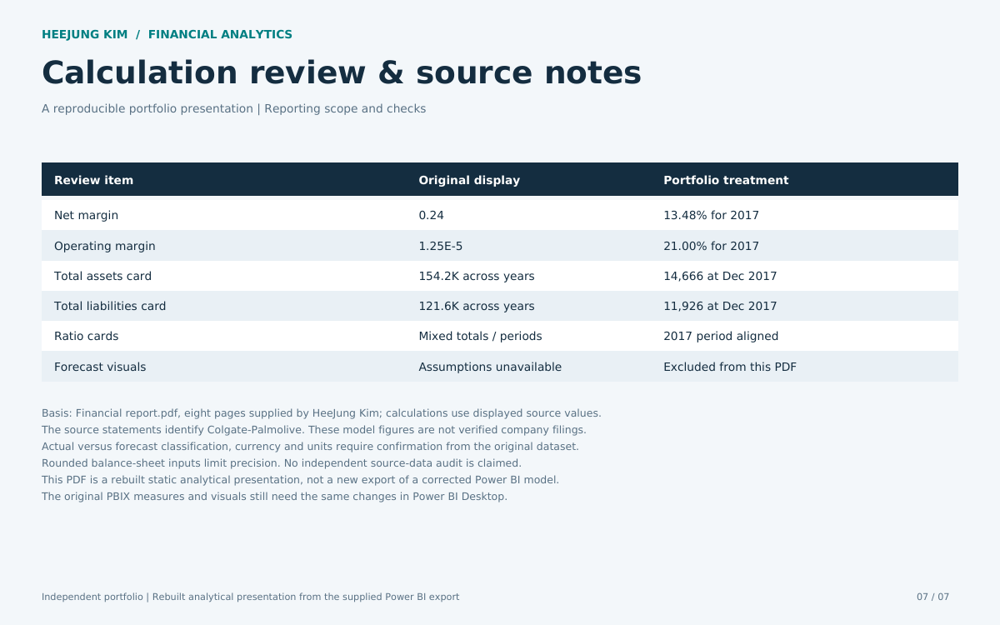
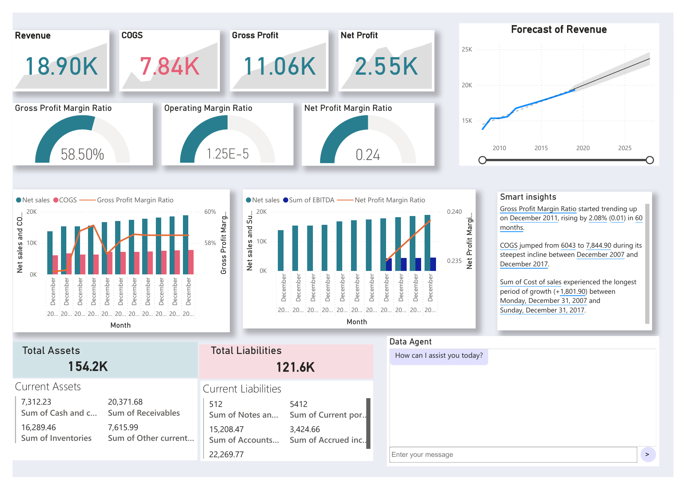
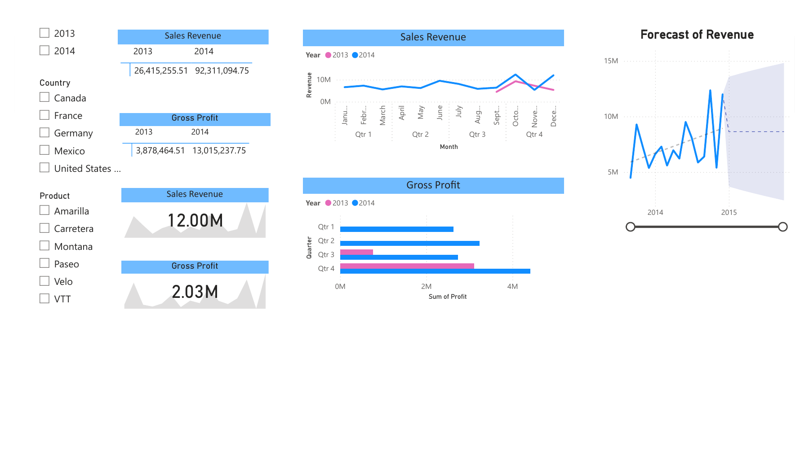
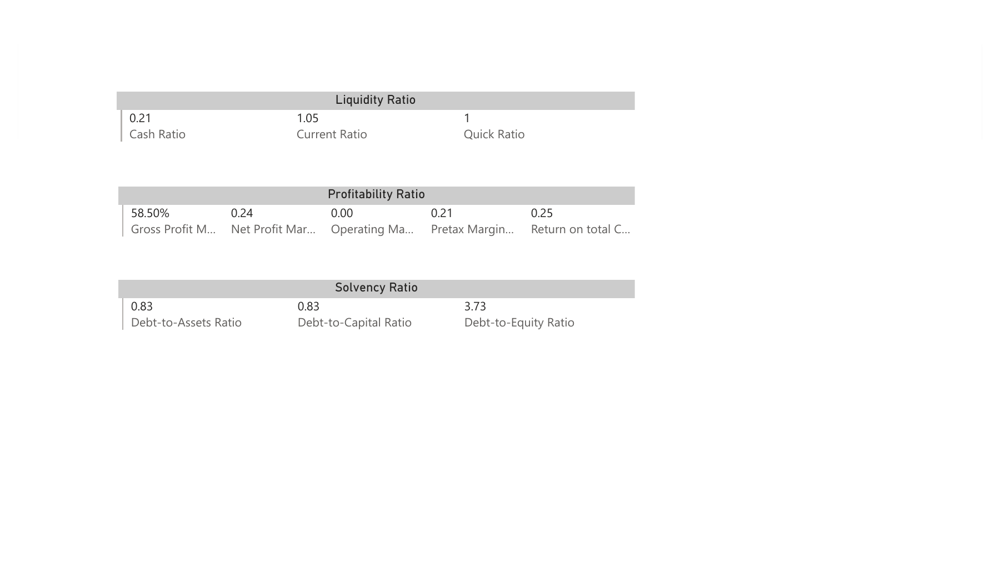

# Financial Reporting & Analysis

**HeeJung Kim | Power BI · Financial Reporting · KPI Analysis**

My Power BI financial analysis project explores profitability, liquidity, cash flow and working capital.

**[Download the analytical report](reports/HeeJung_Kim_Financial_Portfolio.pdf)** · [Original Power BI export](reports/Original_PowerBI_Export.pdf)

## Reporting scope

The financial analysis covers December 2017. A separate sales sample covers 2013–2014. The PDF includes recalculated ratios and year-end balance-sheet figures; these changes have not yet been applied to the PBIX.

The model contains Colgate-Palmolive-labelled statements. Currency, scale and actual versus forecast classification need confirmation. The figures have not been checked against company filings.

## Key findings

- Gross margin: **58.50%**; operating margin: **21.00%**; attributable net margin: **13.48%** for 2017.
- Closing assets **14,666** reconcile to liabilities **11,926** plus equity **2,740**.
- Current ratio **1.04x** and cash ratio **0.11x** support closer review of near-term liquidity.
- Operating cash flow less capital expenditure is **2,526.46**; financing outflows absorb this amount.

## Portfolio gallery

Completed pages from the analytical PDF. Select an image for full size.

### 1. Executive overview

### 2. Income statement

### 3. Balance sheet and liquidity

### 4. Cash flow and funding

### 5. Working capital and ratios

### 6. Separate sales sample

### 7. Calculation review

## Original Power BI dashboards

Screenshots from my Power BI report show the dashboard layouts and visuals. They retain the original calculations, including the margin and balance-sheet aggregation issues documented in the PDF. Refer to the analytical report for recalculated 2017 figures. Forecasts remain unvalidated.

### Financial dashboard

### Sales dashboard

### Financial ratios dashboard

## Review notes

Calculations use source-displayed values and rounded balance-sheet inputs. The unexplained 2017 gross-profit-to-EBIT bridge of 472.58 is retained as an open source-data question. Forecasts are excluded because their assumptions are not documented. The last PDF page records corrections and limitations.

[AR Collection Portfolio](https://github.com/hjkim20022/HeeJung_Kim_AR_Collection_Portfolio) · [GitHub](https://github.com/hjkim20022) · [LinkedIn](https://www.linkedin.com/in/hee-jung-kim-1428781bb/)
