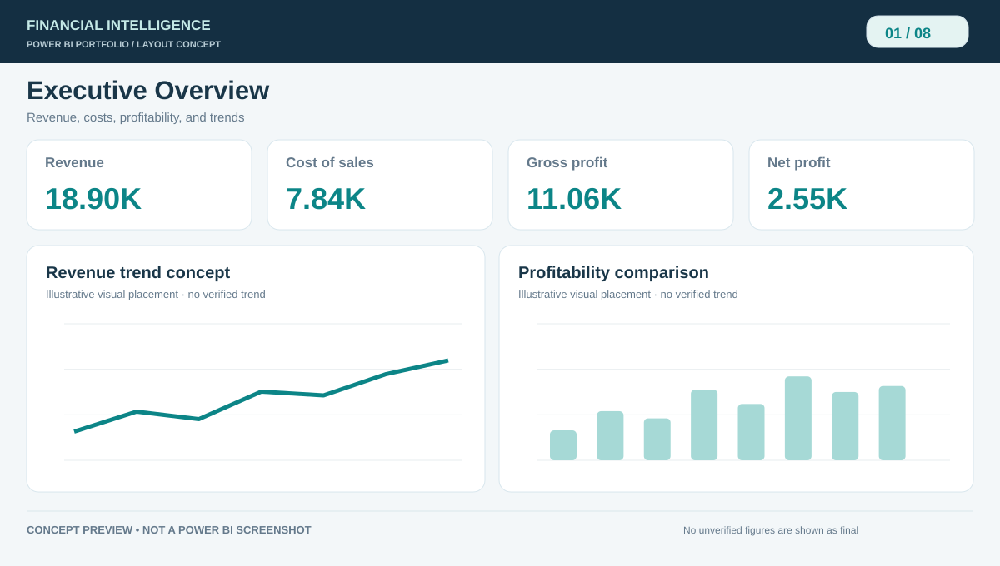
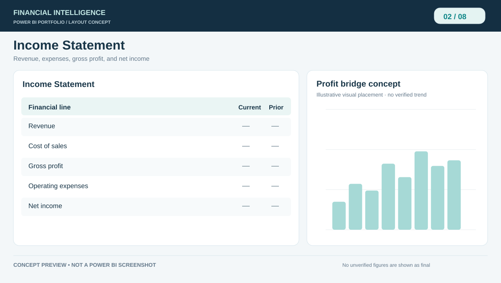
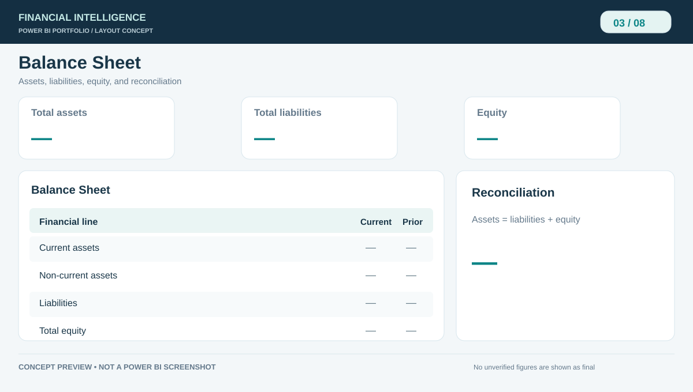
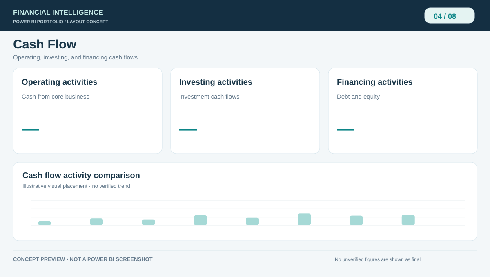
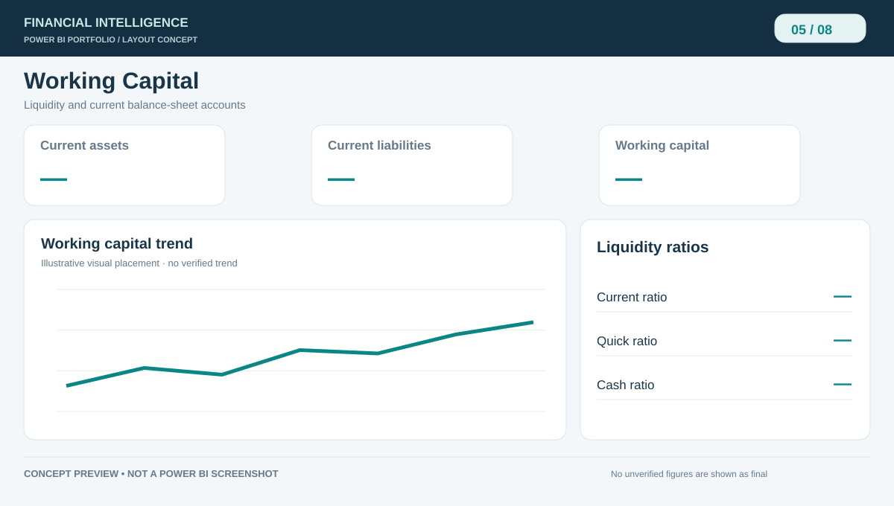
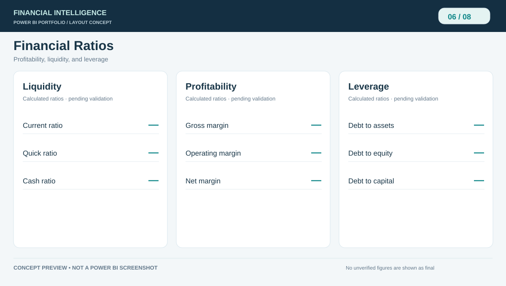
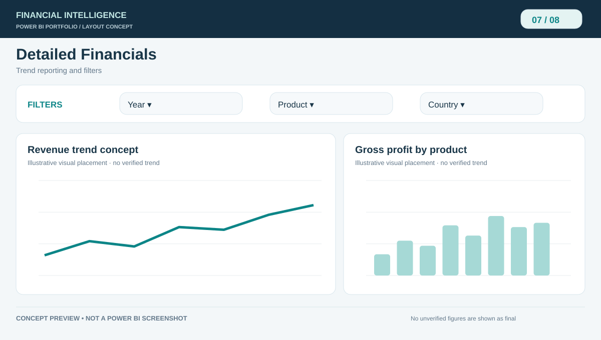
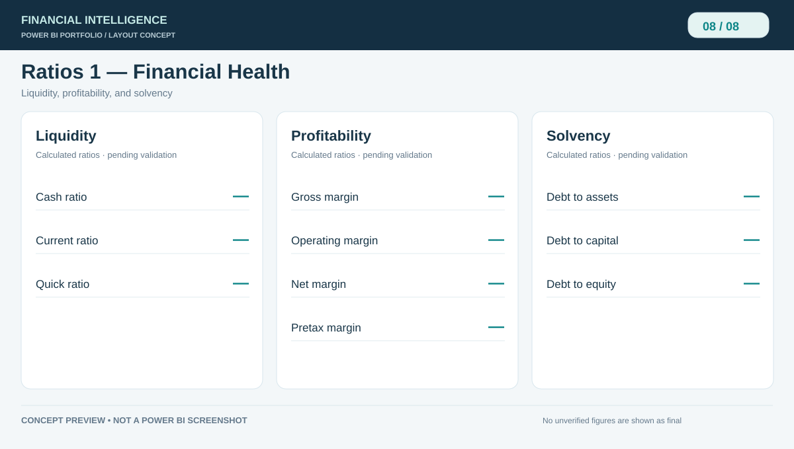

# Power BI Financial Analysis Portfolio

### HeeJung Kim · Project Owner

**Financial Analysis · Power BI · DAX · KPI Reporting · Data Visualization**

This independent portfolio project presents my eight-page Power BI financial report and the analytical questions behind it. I use financial statements, profitability measures, working capital, and ratio analysis to examine business performance and communicate key financial information clearly.

This repository brings together my financial reporting case study, illustrated report layouts, and quality review checklist. The report covers executive KPIs, financial statements, working capital, and financial ratios.

**[View the portfolio gallery](#portfolio-gallery)** · **[GitHub profile](https://github.com/hjkim20022)**

**Project owner:** HeeJung Kim · Independent portfolio project.

## Project highlights

- **Executive reporting:** KPIs for revenue, cost of goods sold, gross profit, and net profit.
- **Financial statement analysis:** Income Statement, Balance Sheet, and Cash Flow reporting.
- **Liquidity and financial health:** Working Capital, profitability margins, liquidity ratios, and leverage ratios.
- **Reporting design:** Information hierarchy, understandable number formats, consistent styling, and clear navigation.
- **Data quality:** Reviewing DAX measures, filter context, accounting reconciliations, and differences between model sources.

## Financial report pages

| Page | Business purpose | Reporting focus |
|---|---|---|
| **Dashboard** | Summarize financial performance | Executive KPI cards, concise comparisons, readable trends |
| **IS — Income Statement** | Analyze revenues, expenses, and earnings | Strong subtotal hierarchy and consistent number formats |
| **BS — Balance Sheet** | Review assets, liabilities, and equity | Clear groupings and balance checks |
| **CF — Cash Flow** | Examine operating, investing, and financing activities | Clean activity sections and reconciled cash movements |
| **WC — Working Capital** | Assess short-term liquidity | Current assets/liabilities and working capital reporting |
| **Ratios** | Review detailed financial measures | Logical groups, definitions, and percent-vs-multiple formatting |
| **Financials** | Explore revenue and profit drivers | Clear slicers, period trends, and category analysis |
| **Ratios 1** | Compare profitability, liquidity, and solvency | Three financial-health sections instead of crowded multi-row cards |

## Portfolio gallery

These illustrations show proposed layouts for my financial report. Final Power BI screenshots will be added after the layouts and calculations are verified in Power BI Desktop.

**Select any image to open it at full size.**

### Executive Overview

### Income Statement

### Balance Sheet

### Cash Flow

### Working Capital

### Financial Ratios

### Detailed Financials

### Financial Health

## Original dashboard KPI snapshot

The following amounts were **displayed on the original Power BI Service dashboard**. They are recorded as examples of the report, not independently audited results. Reporting period and currency are not yet confirmed here.

| Measure | Value displayed |
|---|---:|
| Revenue | 18.90K |
| Cost of goods sold | 7.84K |
| Gross profit | 11.06K |
| Net profit | 2.55K |

A [labeled schematic of the original layout](assets/original-report-schematic.svg) is included as a reference. It is **not** a screenshot or a replacement for the original Power BI file.

**Calculation review:** The original dashboard displayed Operating Margin Ratio as `1.25E-5` and Net Profit Margin as `0.24`. The correct interpretation and formatting are pending a review of the DAX expressions, data types, reporting periods, and filter context. No corrected values are claimed here.

## Technical approach and evidence

| Area | How it relates to the project |
|---|---|
| Power BI | Eight-page financial report and existing analytical visuals |
| DAX | KPI and ratio measures requiring consistent calculation and formatting |
| Power Query / data model | Financial report transformations and model relationships to be reviewed |
| Financial analysis | Profitability, liquidity, statement structure, and reconciliation |
| Portfolio presentation | Page-level design concepts and documented improvement priorities |

**Available:** original eight-page report, GitHub case study, illustrated portfolio gallery, and Power BI theme.

**In progress:** applying the proposed layouts to the source PBIX, verifying ratios and report data, confirming source attribution, and capturing final Power BI screenshots. See the [report quality checklist](IMPLEMENTATION_CHECKLIST.md).

The original `.pbix` and embedded data are **not publicly included**. I will confirm the source data's origin and publication rights before adding any dataset or Power BI export. The public gallery is not a live Power BI report.

## Repository contents

| File or folder | Contents |
|---|---|
| [`index.html`](index.html) | Website source for the financial reporting case study |
| [`assets/`](assets/) | Eight labeled concept illustrations and an original-layout schematic |
| [`IMPLEMENTATION_CHECKLIST.md`](IMPLEMENTATION_CHECKLIST.md) | Report quality checks and publication status |
| [`powerbi-theme.json`](powerbi-theme.json) | Consistent Power BI colour and typography settings |

## More projects

- [Accounts Receivable & Collections Analytics](https://github.com/hjkim20022/HeeJung_Kim_AR_Collection_Portfolio)
- [Enterprise Retail Analytics Platform](https://github.com/hjkim20022/enterprise-retail-analytics-platform)
- [Databricks CI/CD Project](https://github.com/hjkim20022/databricks-cicd-project)

**HeeJung Kim — Project Owner** · [GitHub](https://github.com/hjkim20022) · [LinkedIn](https://www.linkedin.com/in/hee-jung-kim-1428781bb/)

