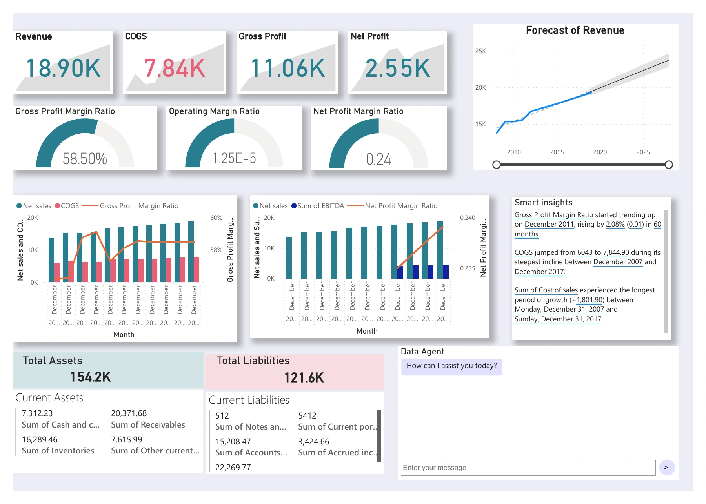

# Power BI Financial Report

**HeeJung Kim · Power BI · DAX · Financial Analysis**

I built this eight-page Power BI report to explore profitability, liquidity, cash flow, and working capital. It includes consolidated statements, financial ratios, and a separate sales dashboard.

[**Open the eight-page report PDF**](reports/Original_PowerBI_Export.pdf) · [**Download the Power BI file (.pbix)**](reports/HeeJung_Kim_Financial_Report.pbix) · [Read the companion analysis](reports/HeeJung_Kim_Financial_Portfolio.pdf)

## Financial dashboard

### Other report pages

- [Income statement](assets/financial-report/01-income-statement.webp), [balance sheet](assets/financial-report/02-balance-sheet.webp), [cash flow](assets/financial-report/03-cash-flow.webp), and [working capital](assets/financial-report/04-working-capital.webp)
- [Ratio table](assets/financial-report/05-ratio-table.webp), [sales dashboard](assets/financial-report/07-sales-dashboard.webp), and [ratio dashboard](assets/financial-report/08-ratio-dashboard.webp)

The previews and PDF open without a Power BI sign-in. Open the PBIX in Power BI Desktop to inspect the report pages and model.

## Companion analysis

The companion analysis recalculates December 2017 profitability and liquidity ratios, including a **58.50% gross margin**, **21.00% operating margin**, and **1.04× current ratio**. In the displayed source units, closing assets of **14,666** equal liabilities of **11,926** plus equity of **2,740**. The [calculation review](assets/calculation-review.png) documents the adjustments and an open gross-profit-to-EBIT reconciliation question.

The original export and PBIX retain their displayed figures. The companion review uses company-labelled source data with currency, scale, and actual-versus-forecast classification still to be confirmed. The 2013–2014 sales sample is separate, and its forecast still needs validation.

[AR & Collections Analytics](https://github.com/hjkim20022/HeeJung_Kim_AR_Collection_Portfolio) · [GitHub profile](https://github.com/hjkim20022) · [LinkedIn](https://www.linkedin.com/in/hee-jung-kim-1428781bb/)
